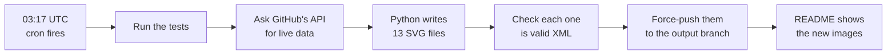

# How this profile works

Everything on [github.com/Zinoxx0](https://github.com/Zinoxx0) is drawn by about 770 lines of Python, using only the
standard library. There is no server, no JavaScript and no third-party widget. A robot redraws the page every night from
live GitHub data, and what looks like a running app is a set of plain images.

This guide explains how, from the big picture down to the tricks. Read it in order the first time. After that,
[Recipes](#13-recipes) is the part you'll come back to.

## Contents

1. [The idea in a minute](#1-the-idea-in-a-minute)
2. [The constraint behind every decision](#2-the-constraint-behind-every-decision)
3. [Map of the repo](#3-map-of-the-repo)
4. [One night in the life of the page](#4-one-night-in-the-life-of-the-page)
5. [The drawing kit](#5-the-drawing-kit-genkitpy)
6. [The alphabet](#6-the-alphabet-genletterspy)
7. [The hero](#7-the-hero-genheropy)
8. [The panels](#8-the-panels-genpanelspy)
9. [The README](#9-the-readme)
10. [The robot](#10-the-robot)
11. [Performance](#11-performance)
12. [Tests](#12-tests)
13. [Recipes](#13-recipes)
14. [Learn by breaking it](#14-learn-by-breaking-it)

---

## 1. The idea in a minute

A GitHub README can't run code, so the page is made of **SVG images**. An SVG is a text file, which means Python can
write one with string formatting. SVGs can also carry **CSS animations**, which keep running inside a plain ``.
So the whole project is one trick done carefully:

> Fetch real data, write it into SVG text files with animations baked in, and publish the files where the README can
> load them.

The design rule on top of that: **every number on the page is real.** Nothing is decoration. The commit counts, the
hashes, the push dates and the bars come from the GitHub API. The orbits are computed. Even the session clock is true:
it counts how long you've had the image open.

The page is numbered like a hex dump, from `0x00` to `0x2A`, so it ends on 42. And 42 in binary is `101010`, which is
the six-bar mark on the first and last panels.

## 2. The constraint behind every decision

Most choices in this repo only make sense once you know what an SVG is allowed to do inside an `` on GitHub.

| Allowed | Not allowed |
|---|---|
| Shapes, gradients, clip paths | JavaScript of any kind |
| CSS in a `<style>` tag, including `@keyframes` | External fonts, images or stylesheets |
| Images embedded as `data:` URIs | Links inside the image |
| Media queries such as `prefers-reduced-motion` | Hover or any other interaction |

Each rule forces a technique:

- **No fonts** means text is drawn as vector outlines ([section 5](#text-without-fonts)).
- **No links** means anything clickable is its own image. That's why the process table is eight images and not one.
- **No JavaScript** means no real clock and no state. Animations can only be scheduled in advance.
- **No interaction** means the page has to look alive on its own.

The images are served from `raw.githubusercontent.com` with this security header:

```
Content-Security-Policy: default-src 'none'; style-src 'unsafe-inline'; sandbox
```

That is why inline CSS works and an external file wouldn't.

## 3. Map of the repo

```
README.md               the page itself: text, plus links to the images
HOW_IT_WORKS.md         this file
assets/                 the three desktop screenshots in the Atom panel
gen/
  build.py              the entry point: fetches data, draws everything, writes dist/
  kit.py                the drawing kit every image shares
  letters.py            the hand-made stroke alphabet and the wordmark
  hero.py               the first panel: wordmark and orbital map
  panels.py             everything below the hero
  make_data.py          rebuilds gen/data/, only ever run by hand
  data/
    glyphs.json         Geist Mono as vector outlines
    palettes.json       the rice's palette engine, run on the three screenshots
    libt-run.txt        a recorded real run of Libft_Tester
    NOTICE.md           licences
tests/test_gen.py       the test suite
.github/workflows/      the nightly robot
dist/                   build output, ignored by git
```

There are two branches that matter:

| Branch | Holds | History |
|---|---|---|
| `main` | The source above | Normal, readable commits |
| `output` | Only the generated SVGs | One commit, force-pushed every night |

The README loads images from `output`. Generated files change daily, so keeping them out of `main` keeps its history
clean and the repo small.

## 4. One night in the life of the page



The heart of it is `render()` in `gen/build.py`, which turns the API's answer into a dictionary of file name to SVG
text:

```python
images = {
    "hero": hero.hero(every[:ORBITS], weeks, stats),
    "atom": panels.atom(by_name["Atom-Plasma"]["commits"]),
    "libt": panels.libt(by_name["Libft_Tester"]["commits"]),
    "ps-head": panels.table_head(),
    "stack": panels.stack(languages(user)),
    "eof": panels.eof(stamp),
}
```

The data comes from one GraphQL query in `QUERY`: the contribution calendar, plus each public repo's push date,
languages, commit count and latest commit hash. `repos()` cleans that up and sorts it freshest first. The profile repo
itself is skipped through `SKIP_REPOS`, because a robot commits to it nightly, which would skew every number.

**Failing on purpose.** Nothing in `build.py` catches errors. If a repo is missing or an image is broken, the run dies
before publishing, and yesterday's images stay up. A stale page beats a broken one.

## 5. The drawing kit (`gen/kit.py`)

### An SVG is just text

Here is a complete animated SVG:

```xml
<svg xmlns="http://www.w3.org/2000/svg" viewBox="0 0 100 100">
  <style>
    @keyframes slide { to { transform: translateX(80px) } }
    .dot { animation: slide 2s infinite alternate }
  </style>
  <circle class="dot" cx="10" cy="50" r="8" fill="#c6ff3d"/>
</svg>
```

Save it as `dot.svg`, open it in a browser, and it moves. Everything else in this repo is a larger version of that.

The `Svg` class collects the pieces (`css`, `defs`, `parts`) and `render()` joins them into one string. A panel is
always the same shape:

```python
s = Svg(height, "Title for screen readers")
plate(s, "0x10", "ATOM PLASMA")
s.add(...)
return s.render()
```

### Text without fonts

An SVG in an `` can't load a font, so `make_data.py fonts` extracts the outline of every character from Geist Mono
and stores them in `glyphs.json`. To avoid repeating an outline, `Svg.text()` defines each character once and stamps
it with `<use>`:

```xml
<defs>
  <path id="g0" d="M120 0 ..."/>                 <!-- the letter A, once -->
</defs>
<g fill="#e8ebe6" transform="translate(24 33) scale(0.0110)">
  <use href="#g0" x="0"/>                         <!-- stamped here -->
  <use href="#g0" x="600"/>                       <!-- and here, one letter along -->
</g>
```

Glyphs are stored at 1000 units per em, so `scale(0.0110)` means 11 px text. Every character in Geist Mono is 600 units
wide, which makes the columns line up.

The cost: only characters in `CHARS` in `make_data.py` exist. Use anything else and the build stops with a `KeyError`.

### The palette

Six constants at the top of `kit.py` colour the whole page. Keeping to one accent, `SIG`, is most of what makes it
look deliberate:

| Name | Value | Used for |
|---|---|---|
| `VOID` | `#08090b` | Panel background |
| `LINE` | `#1e2326` | Hairlines, the dot grid |
| `FAINT` | `#2c3235` | Things that should be seen but not noticed |
| `DIM` | `#7f8783` | Labels |
| `INK` | `#e8ebe6` | Values |
| `SIG` | `#c6ff3d` | The one signal colour |

### The small parts

- `plate()` draws a panel's background with the cut top-right corner, then its address and name.
- `dots()` draws the grid everything hangs from, an idea taken from the interfaces in the film *Oblivion*.
- `sigil()` draws `101010` as six bars.
- `arrow()` is the small mark that says "this opens something".
- `num()` writes numbers as short as possible, so `0.25` becomes `.25`. Across thousands of coordinates, that adds up.

## 6. The alphabet (`gen/letters.py`)

The big titles aren't a font. They're a small alphabet drawn for this page as **centre lines**: a stroke is a list of
points, on a grid where capitals are 100 tall.

```python
"L": (120, [[(0, 0), (0, 100), (120, 100)]]),
#     │      └ one stroke: down, then across
#     └ the letter's width
```

A third number rounds a corner. This is the letter C, with both its left corners rounded by `R`:

```python
"C": (130, [[(130, 0), (0, 0, R), (0, 100, R), (130, 100)]]),
```

`_line()` turns those points into an SVG path. To round a corner it stops `r` short of it, then curves through the
corner with a quadratic `Q` to a point `r` past it.

Strokes have three advantages over outlines: a title costs a few hundred bytes, it stays sharp at any size, and it can
**draw itself on** (see [section 7](#drawing-lines-on)).

### The wordmark

`WORDMARK` is cut by hand. Wherever two strokes would cross or touch, one stops short:

```python
(130, [[(0, 0), (130, 100)], [(130, 0), (78, 40)], [(52, 60), (0, 100)]]),   # X
#       the long stroke       the short stroke, in two pieces
```

That gap is the detail that makes it look designed, not typed. The O has the same cut corner as the panels. And in
`wordmark()`, one stroke of the last X is drawn in `SIG`.

`spaced()` works out the gap between letters so the wordmark spans an exact width.

## 7. The hero (`gen/hero.py`)

The concept: **each repo is a body in orbit, and the closer it is to the core, the more recently you pushed to it.**
What you're working on sits near the middle. What you've left drifts out. Because the map is rebuilt every night, it
genuinely changes as you work.

Each body's meaning:

| Property | Comes from |
|---|---|
| Orbit | Recency rank: freshest repo on the inner orbit |
| Size | Commit count, capped at 120 |
| Colour | Lime if pushed in the last 30 days (`ACTIVE_DAYS`) |
| Speed | Kepler's third law |

### Faking 3D

There is no 3D engine, just one function:

```python
def plane(r, angle):
    return CX + r * math.cos(angle), CY + r * TILT * math.sin(angle)
```

The first half is an ordinary circle. Multiplying `y` by `TILT` squashes it into an ellipse, which is exactly what a
circle looks like when it's tilted away from you. `TILT = .27` means the orbit appears 27% as tall as it is wide.

Two small cues sell the depth:

- Bodies grow near the front: `depth = 1 + .22 * math.sin(...)`.
- The orbit lines are a gradient, dim at the far side and brighter at the near side.

### Kepler's third law

Outer planets move slower, and the rule is T² ∝ r³. So the period grows as `r` to the power 1.5:

```python
def period(r):
    return max(1, round(BASE_PERIOD * (r / NEAREST) ** 1.5 / 32)) * 32
```

The result is rounded to a multiple of 32 seconds, for a reason explained next. That rounding means the law is close
but not exact, and the third and fourth orbits end up sharing a period:

| Orbit | Radius | Exact Kepler | Used |
|---|---|---|---|
| 1 | 186 | 64 s | 64 s |
| 2 | 230 | 88 s | 96 s |
| 3 | 274 | 114 s | 128 s |
| 4 | 318 | 143 s | 128 s |
| 5 | 362 | 174 s | 160 s |
| 6 | 406 | 206 s | 192 s |
| 7 | 450 | 241 s | 256 s |

### Moving a body

CSS can't follow a formula, but it can follow a list of positions. `orbit()` works out 64 points around the ellipse
and writes one keyframe for each:

```css
@keyframes b0 {
  0%     { transform: translate(642.26px,404.35px) scale(1.14) }
  1.56%  { transform: translate(629.83px,407.96px) scale(1.16) }
  /* 62 more */
  100%   { transform: translate(642.26px,404.35px) scale(1.14) }
}
.b0 { animation: b0 64s steps(10) infinite }
```

The browser moves in straight lines between keyframes, but with 64 of them the error on the biggest orbit is about half
a unit. You can't see it.

**Why `steps(10)` and not smooth motion?** This is the most important line in the project. `steps(10)` means "don't
glide, jump ten times between each pair of keyframes". Without it, the browser would repaint at 60 fps.

Here's the arithmetic that ties it together, with `FPS = 10`:

```
steps per keyframe = seconds in the orbit × FPS ÷ 64 keyframes

orbit 1:  64 s × 10 ÷ 64 = 10
orbit 2:  96 s × 10 ÷ 64 = 15
orbit 7: 256 s × 10 ÷ 64 = 40
```

Each one works out to exactly 10 jumps a second, and they all start at the same moment, so **all seven bodies jump on
the same frames**. The browser repaints 10 times a second, not 70. And that's why periods are multiples of 32: it
guarantees the division comes out whole.

### Drawing lines on

The wordmark and orbits draw themselves with a dash trick. Give a line a dash as long as the line, then slide that dash
away:

```css
.draw { stroke-dasharray: 1.01 1; animation: draw 1.3s cubic-bezier(.3,.7,.1,1) both }
@keyframes draw { from { stroke-dashoffset: 1.01 } to { stroke-dashoffset: 0 } }
```

At the start, the offset pushes the visible dash completely off the line. As it reaches zero, the dash slides in and the
line appears from its start to its end.

Two details make it work:

- `pathLength="1"` on each path tells the browser to treat that line as exactly 1 unit long, whatever its real length.
  So one CSS rule fits every stroke. It's `1.01` and not `1` so a closed shape has no hairline gap where it meets.
- `both` means "hold the first frame during the delay, and hold the last frame after the end". Each stroke has its own
  `animation-delay`, which makes them stagger.

### Labels that resolve out of noise

`decode()` is a flipbook. For a label it writes 9 complete copies of the text, each with fewer characters scrambled,
then the real text:

```
/_1x_ _#xxx_%      ← frame 0
SAMI% _#_*#/1      ← frame 3
SAMIR ME/1__0      ← frame 6
SAMIR MERCADO      ← the real text
```

Each garbled copy is hidden, and is visible for .055 s at its turn:

```css
.flash { visibility: hidden; animation: flash .055s step-end }
@keyframes flash { from, to { visibility: visible } }
```

The real text is the reverse: visible by default, and held hidden only until its delay ends. The noise comes from a
random generator seeded with the text, so the output is the same on every build.

### The session clock

An image can't read the time, but it can count from when it opened. Each digit is a column of numbers behind a small
clip window, and the column slides up one notch at a time:

```python
for digit, (count, seconds) in enumerate(((6, 3600), (10, 600), (6, 60), (10, 10))):
```

The last digit holds 0 to 9 and takes 10 seconds to pass through them with `steps(10)`, so it ticks once a second. The
next holds 0 to 5 and takes 60 seconds. It's an odometer, and it costs only one repaint a second.

### The tracker and the 42-second pass

Every 6 seconds the tracker moves to the next body and the readout changes. There's one animation for all of them:

```css
@keyframes slot { 0%, 14.26% { visibility: visible } 14.27%, 100% { visibility: hidden } }
.slot { visibility: hidden; animation: slot 42s step-end infinite }
```

An element is on for the first seventh of a 42-second loop. To take turns, each body gets a different **negative
delay**, which starts its animation already part-way through:

| Body | `animation-delay` | Its turn starts at |
|---|---|---|
| 1 | `-42s` | 0 s |
| 2 | `-36s` | 6 s |
| 3 | `-30s` | 12 s |
| 7 | `-6s` | 36 s |

Seven bodies at 6 seconds each is 42 seconds. That's not a coincidence, and there's a test for it.

The keyframe stops at 14.26% and not the true 14.29%. If two turns touched exactly, rounding could show both readouts
for one frame, and the text would flicker.

### The year ring

`year_ring()` stands a bar on the plane for each week of the contribution calendar. Heights use a logarithm:

```python
y - 6 - 42 * math.log1p(week) / busiest
```

Your busiest week had 85 contributions and an ordinary one had a few. On a straight scale the small weeks would vanish.
On a log scale, they stay visible.

### Layers

SVG has no z-index: whatever's drawn later is on top. `hero()` draws in this order, and the order is the design:

1. Background and dot grid
2. Wordmark and labels
3. Orbit lines
4. Year ring and core
5. Bodies
6. **Corner fades**: two soft ellipses in the background colour
7. Readouts

The corner fades go over the bodies but under the readouts, so a body sliding into the bottom corner dims away instead of
colliding with the text.

## 8. The panels (`gen/panels.py`)

### Atom Plasma: the wipe

Three screenshots are embedded in the SVG as base64. They're defined once in `<defs>` and stacked with `<use>`, so the
image data isn't repeated even though the first one appears twice:

```
top     teal again   ← wipes in last, and closes the loop
        ink
        lilac
bottom  teal
```

Each upper layer starts fully clipped and wipes in:

```css
@keyframes w1 {
  0%      { clip-path: inset(0 100% 0 0) }
  28.33%  { clip-path: inset(0 100% 0 0); animation-timing-function: steps(22) }
  33.33%, 100% { clip-path: inset(0 0 0 0) }
}
```

`inset(0 100% 0 0)` cuts 100% from the right, so nothing shows. `inset(0 0 0 0)` shows everything. Over 18 seconds, the
wipes run at 5.1, 11.1 and 17.1 s. When the loop restarts, the top teal layer disappears to reveal the bottom teal,
which looks identical, so you never see the seam.

A thin lime bar follows the wipe's edge, on the same timing. Each palette switches halfway through its wipe.

The swatches are the real output of Atom Plasma's palette engine, run on those screenshots by `make_data.py palettes`.
This is the only colour on the page, because colour is what the project does.

### Libft Tester: the board

`functions()` reads the 43 function names from a recorded real run, and refuses to build if that run didn't pass. Each
cell is drawn twice: a dim version, and a bright one on top that's switched on at its moment:

```python
at = 1 + i * PASS_AT    # one function every .16 s, starting at 1 s
```

Every cell has its own keyframes, because each one's timing differs. The cycle (`RUN`) is 30 seconds, most of it holding
the finished board, and the panel resets at 98%.

### The process table

Each row is a separate image so each can be a separate link. `build.TABLE` fixes the order, because links in the README
can't change. The state is computed: `RUNNING` if pushed in the last 30 days, otherwise `IDLE`.

### Stack and EOF

`stack()` draws your languages by bytes across all public repos. `eof()` closes the page, with the only blinking cursor
on it: `0b101010 = 42 = 0x2A = '*'`, which is true, since 42 is the ASCII code for an asterisk.

### The finished picture rule

This matters in every panel: **the CSS without animations must be the finished picture.**

Animations only borrow from that final state. Every image ends with this line:

```css
@media (prefers-reduced-motion: reduce) { * { animation: none !important } }
```

A visitor who has turned off animations in their system settings then gets a complete still. Check the pattern in the
code: wordmark lines rest at their final dash, the libft board rests fully lit, the noise frames rest hidden, and only
the first tracker slot rests visible.

## 9. The README

`README.md` is short, because the images do the work. Three habits are worth knowing:

- **`<samp>`** renders real text in a monospace font, and it adapts to light and dark themes. The bio and contact links
  use it, so they stay selectable and accessible. The idea comes from [antfu's profile](https://github.com/antfu).
- **Every image is wrapped in `<a>`.** An `` alone on a line becomes a raw HTML block, which sits differently from
  the images around it. There's a test for this.
- **Every image has real alt text**, so a screen reader or a failed load still says what's there.

## 10. The robot

`.github/workflows/refresh.yml` runs at 03:17 UTC every day, and on any push to `main` that touches `gen/` or `assets/`.

| Step | What it does |
|---|---|
| Test | Runs the suite. A failure stops everything. |
| Draw | Runs `gen/build.py`, using the workflow's own `GITHUB_TOKEN`. |
| Publish | Runs `git init` inside `dist/`, makes one commit and force-pushes it to `output`. |
| Keep the schedule alive | GitHub pauses scheduled workflows after 60 days without activity, so after 45 quiet days it adds an empty commit to `main`. |

The force-push is why `output` always has one commit: history that nobody needs never piles up.

After a publish, GitHub's raw file cache (`max-age=300`) can serve old images for up to five minutes.

## 11. Performance

**The rule that explains everything:** when anything in an SVG `` changes, the browser repaints the *whole image*.
So what matters is how often something changes, more than how much changes.

All of the design's restraint comes from that:

| Rule | Why |
|---|---|
| Everything looping uses `steps()` or `step-end` | Otherwise the browser repaints at 60 fps |
| Everything shares one 10 fps grid | Seven unsynchronised bodies would mean seven times the repaints |
| No filters, no group opacity | Each needs an expensive off-screen layer. Glows are gradients. |
| Between moves, nothing changes at all | See below |

**The most useful lesson here.** The Atom panel moves for about 15% of the time, yet it was using 44% of a core in
Firefox. The cause was the scan bar: between wipes it was invisible, but it was still sliding back to its start. A
hidden element that's still changing makes the browser repaint three screenshots every frame, for nothing. Holding it
still between wipes dropped the cost to 5%.

Measured with software rendering, as a share of one CPU core. Each image was measured alone, and the last row is the
real page on github.com, which also carries GitHub's own interface:

| Image | Firefox | Chrome |
|---|---|---|
| Hero | 26% | 10% |
| Atom Plasma | 5% | 3% |
| Libft Tester | 5% | 3% |
| Whole page on github.com | 34% | 19% |

If you ever measure a panel at 0%, don't celebrate: the image probably failed to load. Check a render first.

## 12. Tests

```sh
python3 -m unittest discover -s tests
```

The tests in `tests/test_gen.py` use made-up data, so they need no network. They're written around things that really
went wrong, so read them as a list of lessons:

- `Images`: valid XML, nothing an `` would block, and every animation has its keyframes.
- `Motion`: nothing runs forever unstepped, wipes hold still, tracker slots never overlap, a pass is 42 seconds.
- `Orbits`: Kepler's law holds, periods make whole steps, and every orbit fits the panel.
- `Data`: the profile is skipped, a missing repo stops the run, and the recorded tester run passed.
- `Readme`: every image exists, is used, has alt text and isn't alone on a line.

A good habit: when you fix a bug, break it again on purpose and confirm a test fails. If none does, the test you wrote
doesn't protect you.

## 13. Recipes

### See your changes locally

Draw everything, then open one image in a browser. Animations run, and you can reload to replay the intro:

```sh
python3 gen/build.py         # needs a logged-in gh
zen dist/hero.svg
```

To see the whole page, have GitHub render the README, with the image links pointed at your local build:

```sh
gh api markdown -f mode=markdown -f text="$(cat README.md)" \
  | sed 's#https://raw.githubusercontent.com/Zinoxx0/Zinoxx0/output/##g' > dist/preview.html
zen dist/preview.html
```

Use `mode=markdown`, not `gfm`. The `gfm` mode is for comments and turns line breaks into `<br>`, which changes the
spacing. The preview is unstyled, so it's for checking layout. `dist/` is ignored by git, and the next build clears it.

### Change the wording

The bio and contact links are in `README.md`. The hero's three columns are in `columns` in `hero()`. Project
descriptions are in `atom()` and `libt()`. If a character isn't in `CHARS`, add it and run `python3 gen/make_data.py fonts`.

### Change the accent colour

Change `SIG` in `gen/kit.py`. That's all of it.

### Add a repo to the table

1. Add its exact name to `TABLE` in `gen/build.py`.
2. Add a row to `README.md`, copying an existing one. The image is `ps-` plus the lowercase name.

The orbital map needs nothing: it always shows the seven freshest repos. Tests catch a missing row or image.

### A repo was renamed or deleted

The build stops with a `KeyError`, and the old images stay up. Update `TABLE` and `README.md`.

### Add a panel

1. Write a function in `gen/panels.py` that returns `s.render()`.
2. Add it to the `images` dictionary in `render()` in `gen/build.py`.
3. Add `<a href="..."></a>` to `README.md`.

To keep the numbering, the new panel's address goes between `0x00` and `0x2A`.

### Add a letter to the alphabet

Add it to `ALPHABET` in `gen/letters.py`, on the 100-tall grid. `title()` uses it right away. `ALPHABET` only holds the
letters used so far, so the next title you write may need one.

### Refresh the recorded data

```sh
python3 gen/make_data.py libt       # a new real tester run, needs the Libft and Libft_Tester repos
python3 gen/make_data.py palettes   # the palette engine again, needs Atom Plasma installed
python3 gen/make_data.py fonts      # the outlines again, after changing CHARS or FACES
```

### Replace the screenshots

Put new files at `assets/atom-teal.webp`, `atom-lilac.webp` and `atom-ink.webp`, then run:

```sh
python3 gen/make_data.py shots palettes
```

This repo is public and screenshots are forever, so look over each one for anything private first. To use other names,
change `SHOTS` in both `gen/panels.py` and `gen/make_data.py`.

### Redraw without waiting for the night

```sh
gh workflow run refresh.yml
```

## 14. Learn by breaking it

Each of these takes a minute and teaches one idea. Run `python3 gen/build.py`, open `dist/hero.svg`, and undo with
`git checkout gen/` when you're done.

1. **Tilt the plane.** Set `TILT = .6` in `hero.py`. The rings open up as if you'd moved the camera above them. Try `.1`.
2. **Feel the frame rate.** Set `FPS = 4` in `kit.py`. The bodies now visibly tick, which shows what `steps()` is doing.
3. **Slow the tracker.** Set `SLOT = 2`, and it races. Then run the tests and read why one fails.
4. **Break the still.** Remove `visibility:hidden;` from `.slot`, turn on reduced motion in your system settings, and
   reload. All seven readouts pile up in one corner, which is the bug the finished picture rule prevents.
5. **Bring back the expensive bug.** It takes two changes in `atom()`. Change `.scan`'s `step-end` to `linear`, and
   delete the `if end < cycle:` block that resets the bar. The bar now slides back while hidden. Compare your CPU usage
   before and after: it went from 5% to 42% of a core in Firefox. Either change alone does nothing, which is worth
   thinking about. Then run the tests and see which ones catch it.
6. **Draw a letter.** Add `"W"` to `ALPHABET`, then use it in a title.

Fonts, licences and data sources are listed in [`gen/data/NOTICE.md`](gen/data/NOTICE.md).
