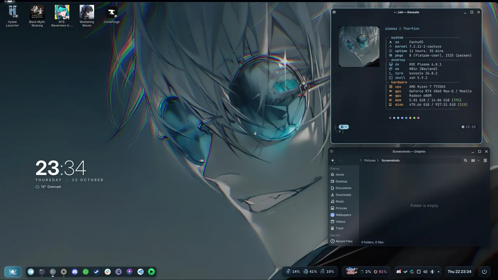
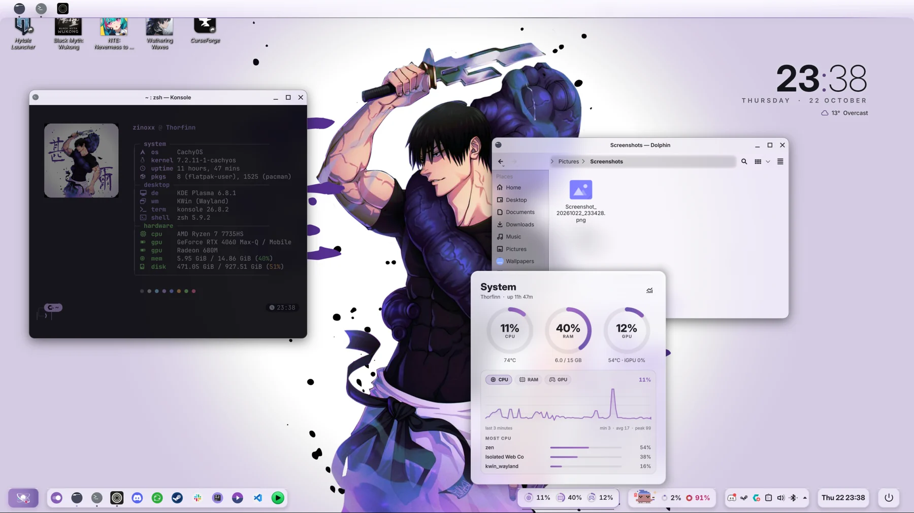
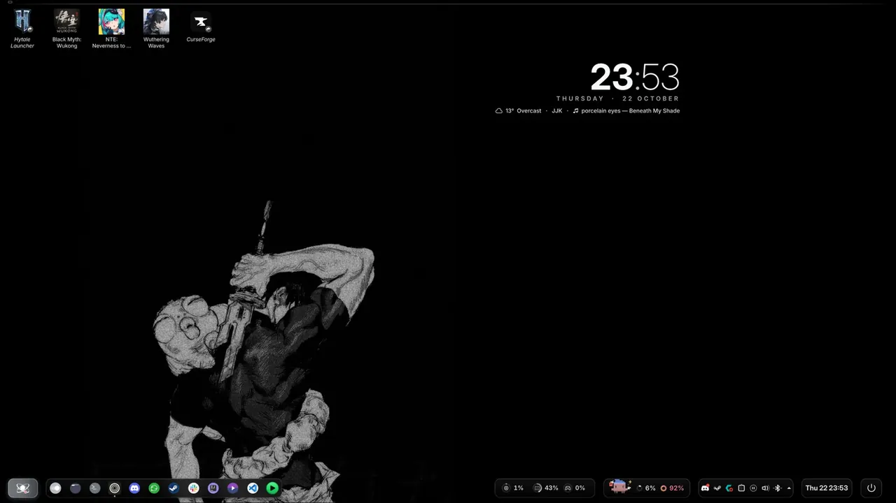

I'm Samir, also known as Zinoxx. I'm a student at [42 Lisboa](https://www.42lisboa.com) (`samercad` on the intra) and co-founder and lead engineer at [ViVia Technologies](https://viviatech.github.io). I also edit VFX, so I care about how software looks as much as how it runs, which is how a desktop theme turned into 22,000 lines of code.

 

The same desktop, three wallpapers. Nothing else was changed.

 

 

MY 42 PROJECTS

 

 

Discord: <code>zinoxx0</code>

 

This page works like Atom Plasma: the sky over Lisbon is the wallpaper, and the page's accents are computed from it by the rice's own palette engine. Today's sunrise, sunset and moon are real, and the images are redrawn every day. <a href="https://github.com/Zinoxx0/Zinoxx0/tree/main/gen">See how it's made</a>.

