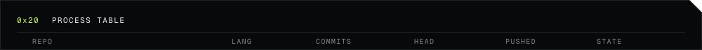
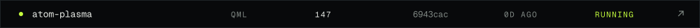
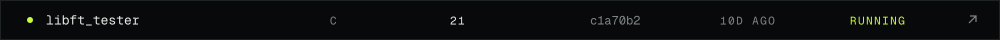
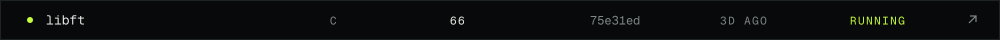
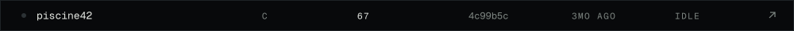
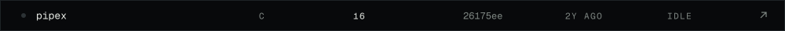
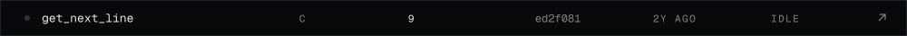
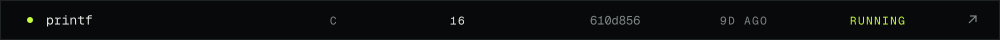
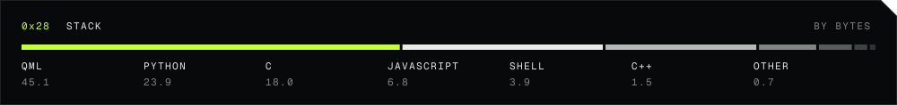

<samp>Bodies are repos: the closer to the core, the more recent the push. Bars are the last 52 weeks. Redrawn nightly.</samp>

<samp>

I'm Samir, also known as Zinoxx: a student at [42 Lisboa](https://www.42lisboa.com) and co-founder and lead engineer at [ViVia Technologies](https://viviatech.github.io). I also edit VFX, so I care about how software looks as much as how it runs, which is how a desktop theme turned into 22,000 lines of code.

</samp>

<samp>
<a href="mailto:samercad@student.42lisboa.com">mail</a> ·
<a href="https://profile.intra.42.fr/users/samercad">intra</a> ·
<a href="https://www.instagram.com/Zinoxx.0">instagram</a> ·
<a href="https://steamcommunity.com/id/Zinoxx1">steam</a> ·
discord: zinoxx0
</samp>

